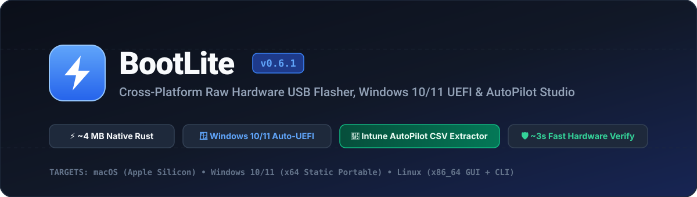

<div align="center">



<br/>

[](https://github.com/namanrathi07/bootlite/releases)
[](#downloads)
[](https://github.com/namanrathi07/bootlite)
[](https://github.com/namanrathi07/bootlite/blob/main/LICENSE)

<p align="center">
  <a href="#downloads"><b>⬇️ Download Binaries</b></a> •
  <a href="#comparison"><b>⚡ Comparison</b></a> •
  <a href="#autopilot-studio"><b>🏢 AutoPilot & Unattended Studio</b></a> •
  <a href="#verification"><b>🔍 Fast Verify (~3s)</b></a> •
  <a href="#cli"><b>💻 CLI</b></a>
</p>

</div>

---

<a id="downloads"></a>
## ⬇️ One-Click Downloads (`v0.6.1`)

All release binaries are built automatically via GitHub Actions CI. You can also browse all versions on the [**GitHub Releases Page**](https://github.com/namanrathi07/bootlite/releases).

| Operating System | Package Format | Direct Download Link |
| :--- | :--- | :--- |
| 🍎 **macOS** *(Apple Silicon M1/M2/M3/M4)* | `.dmg` Disk Image (`BootLite.app`) | [**`BootLite-macOS-AppleSilicon.dmg`**](https://github.com/namanrathi07/bootlite/releases/latest/download/BootLite-macOS-AppleSilicon.dmg) |
| 🪟 **Windows 10 / 11** *(x64 Studio GUI)* | Standalone Portable `.exe` *(0 DLL deps)* | [**`BootLite-Windows-x86_64-Portable.exe`**](https://github.com/namanrathi07/bootlite/releases/latest/download/BootLite-Windows-x86_64-Portable.exe) |
| 🪟 **Windows 10 / 11** *(x64 Headless CLI)* | Standalone CLI `.exe` | [**`bootlite-cli-Windows-x86_64.exe`**](https://github.com/namanrathi07/bootlite/releases/latest/download/bootlite-cli-Windows-x86_64.exe) |
| 🐧 **Linux** *(x86_64 GUI + CLI)* | `.tar.gz` Archive (`bootlite-gui` + `bootlite-cli`) | [**`BootLite-Linux-x86_64.tar.gz`**](https://github.com/namanrathi07/bootlite/releases/latest/download/BootLite-Linux-x86_64.tar.gz) |
| 🔐 **SHA-256 Checksums** | Release Verification Manifest | [**`SHA256SUMS.txt`**](https://github.com/namanrathi07/bootlite/releases/latest/download/SHA256SUMS.txt) |

> **🍎 macOS First-Launch Note:** Run this once after dragging `BootLite.app` to `/Applications`:
> ```bash
> xattr -cr /Applications/BootLite.app
> ```

---

<a id="comparison"></a>
## ⚡ How BootLite Compares

Traditional USB utilities force a compromise: **Rufus** is fast and supports Windows ISOs, but is Windows-only. **balenaEtcher** runs across operating systems, but bundles a ~150 MB Electron/Chromium runtime, cannot build bootable Windows 10/11 USBs, and forces a slow 100% read-back pass. **Ventoy** relies on a custom bootloader shim that can trigger Secure Boot blocks on locked enterprise laptops.

**BootLite (`~4 MB` single binary)** unifies native cross-platform raw flashing, standard UEFI Windows 10/11 media creation, zero-prompt disk format boot, and **Microsoft Intune AutoPilot hardware hash extraction** into a single native Rust application:

| Capability | ⚡ BootLite `v0.6.1` | Rufus `v4.x` | balenaEtcher `v2.x` | Ventoy `v1.x` |
| :--- | :---: | :---: | :---: | :---: |
| **Native macOS, Windows & Linux GUI + CLI** | ✅ All 3 OSes | ❌ Windows Only | ✅ All 3 OSes | ⚠️ Windows / Linux |
| **Windows 10 / 11 UDF ISO Bootable USB Builder** | ✅ Auto (FAT32 UEFI + NTFS/ExFAT) | ✅ Yes | ❌ Fails to boot | ✅ Multi-ISO Shim |
| **Jump Straight to Disk Format (Skip Lang/Key/Edition/EULA)** | ✅ 1-Click Pre-Flash Selector | ❌ No | ❌ No | ❌ No |
| **Windows AutoPilot Hardware Hash Extractor (`\AutoPilot\`)** | ✅ Saves Intune CSV (`AutoPilotHWID_<Serial>.csv`) | ❌ No | ❌ No | ❌ No |
| **Windows 10 / 11 Unattended Setup Studio (`autounattend.xml`)** | ✅ Basic, De-Bloat & Live XML Preview | ✅ Basic Dialog | ❌ No | ⚠️ Manual Plugin |
| **Standard Native UEFI Boot (No Custom Shim Required)** | ✅ 100% Native Boot | ✅ Yes | ✅ Yes | ❌ Custom Bootloader |
| **4 MB / 8 MB High-Throughput Burst Engine** | ✅ Full USB Bus Speed | ✅ Yes | ⚠️ Slow Full Verify | N/A (File Copy) |
| **Smart Verification (`Fast ~3s` / `Full 100%` / `Off`)** | ✅ 3 Selectable Modes | ✅ Optional | ❌ Mandatory Slow Read | ❌ No |
| **On-the-Fly `.xz` (Multi-Stream), `.zst`, `.bz2`, `.gz`** | ✅ Built-in Pure Rust | ✅ Yes | ✅ Yes | ❌ Uncompressed ISO |
| **Partition Scheme Selector (`Auto` / `GPT` / `MBR`)** | ✅ Yes | ✅ Yes | ❌ No | ✅ Yes |
| **One-Click USB ExFAT Reset / Capacity Recovery** | ✅ Built-in | ✅ Yes | ❌ No | ❌ No |
| **Expected SHA-256 Checksum Verifier** | ✅ Pre-Flash & In-Flight | ✅ Yes | ❌ No | ✅ Checksum Plugin |
| **Auto-Eject Hardware on Completion** | ✅ Built-in Toggle | ❌ No | ✅ Yes | ❌ No |
| **Application Footprint** | **~4 MB Native Rust** | ~1.5 MB C | ~150 MB Electron | Bootloader + Tools |

---

<a id="autopilot-studio"></a>
## 🏢 Windows 10/11 Unattended & AutoPilot Studio

When you load any Windows 10 or Windows 11 ISO into **Step 1**, BootLite automatically unlocks its enterprise deployment controls:

### 1. Jump Straight to Disk Format & Pre-Flash Edition Selector
* **Skip Pre-Install Wizard Screens:** Automatically pre-answers the Windows Setup Language, Time/Currency, Keyboard, Product Key prompt (*"I don't have a product key"*), and License Agreement (EULA) so booting from BIOS lands **directly on the Drive Partition / Format screen**.
* **One-Click Edition Bar (`Pro` / `Home` / `Home SL` / `Enterprise` / `Ask Me`):** Pick the target Windows edition right on the main card before clicking Flash.

### 2. Automatic Laptop AutoPilot Hardware Hash Extractor (`\AutoPilot\`)
* BootLite provisions an **`AutoPilot`** folder directly on the USB drive containing `Extract-AutoPilotHash.ps1` and `Extract-AutoPilotHash.cmd`.
* Queries the laptop's WMI `root/cimv2/mdm/dmmap:MDM_DevDetail_Ext01` 4K Hardware Hash, BIOS Serial Number, and Windows Product ID **100% offline** (no internet or PowerShell Gallery required).
* Writes a single clean, deduplicated Microsoft Intune import file per laptop:
  ```text
  \AutoPilot\AutoPilotHWID_<SerialNumber>.csv
  ```

### 3. Hardware Bypasses, Local Account & De-Bloat (`autounattend.xml`)
* **Hardware Bypass:** Removes Windows 11 requirements for TPM 2.0, Secure Boot, and 4 GB+ RAM (`LabConfig`).
* **Offline Account Creation:** Bypasses mandatory Microsoft Account sign-in (`OOBE\BYPASSNRO`) and optionally pre-creates a Local Administrator account with auto-logon.
* **System Clean-Up:** Disables automatic BitLocker encryption, skips OOBE privacy/telemetry prompts, disables consumer bloatware/widgets, restores the classic right-click context menu, and provides a **Live XML Preview** tab with 1-click export.

---

<a id="verification"></a>
## 🔍 Verification Modes & Partition Schemes

| Control | Options | Description |
| :--- | :--- | :--- |
| **Verify Mode** | **`Fast (~3s)`** *(Default)* | Flushes physical USB controller caches and verifies **100% of the 4 MB Sector-0 Boot Record (MBR/GPT)** + **32 evenly spaced 64 KB cryptographic sample blocks** across the drive (or all UEFI `.efi` bootloaders + 512 KB Head/Mid/Tail slices of `boot.wim` & `install.wim` on Windows ISOs). |
| | **`Full (100%)`** | Reads back every single written sector/file across the entire USB drive from physical NAND flash and verifies its full SHA-256 digest. |
| | **`Off`** | Flushes hardware buffers, commits the boot record, and finishes immediately after writing. |
| **Scheme** | **`Auto` / `GPT` / `MBR`** | Preserves `ISOHybrid` tables on Linux images and lets you choose between `GPT` (modern UEFI) and `MBR` (BIOS / UEFI-CSM) for Windows ISO builds and ExFAT USB formatting. |

---

<a id="cli"></a>
## 💻 Command-Line Interface (`bootlite-cli`)

```bash
# 1. List connected external USB & SD drives
bootlite-cli list

# 2. Inspect any image or compressed archive (.iso, .img.xz, .iso.zst, .bz2, .dmg)
bootlite-cli inspect --image Win11_24H2_English_x64.iso

# 3. Flash & verify (choose --verify fast, full, or off; --scheme auto, gpt, or mbr)
sudo bootlite-cli flash \
  --image ubuntu-24.04-desktop-amd64.iso \
  --drive disk4 \
  --scheme auto \
  --verify fast \
  --expected-sha256 <sha256-hash> \
  --eject

# 4. Wipe partition tables & restore a USB stick to full-capacity ExFAT
sudo bootlite-cli reset --drive disk4 --label BOOTLITE --scheme auto
```

---

## 🤝 Contributing & License

Contributions, bug reports, and feature requests are welcome! Please read [**CONTRIBUTING.md**](https://github.com/namanrathi07/bootlite/blob/main/CONTRIBUTING.md) before submitting a Pull Request. Licensed under the [**MIT License**](https://github.com/namanrathi07/bootlite/blob/main/LICENSE).
